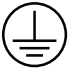

.. _Transport-and-Commissioning:

Transport and Commissioning
***************************

.. _Quick-Start-Guide:

Quick Start Guide
+++++++++++++++++

The following table provides a brief overview for robot usage:

.. csv-table:: Quick start guide
   :file: ./tables/Quick start guide.csv
   :encoding: utf-8-sig
   :widths: 7 17 46 30
   :header-rows: 1
   :class: merge-empty-vertical

.. _Transport and Storage:

Transport and Storage
+++++++++++++++++++++

.. _Transport Requirements:

Transport Requirements
======================

Please use the original packaging to transport the robot. If you want to move the robot later, please keep the original packaging.

When moving the robot from its packaging to the installation position, it should be supported by at least 2 persons until all screws at the robot base are securely fastened.

.. warning::

   - Ensure that the back or other body parts of the operators are not overloaded when the equipment is lifted. Use appropriate lifting equipment. JAKA is not responsible for damage incurred during the transport of the equipment. The robot must be supported by at least two persons depending on the model.
   - Please comply with the relevant lifting regulations in each region and country.
   - Ensure that installation instructions are strictly followed when the robot is installed.

.. attention::

   If the robot is transported without using its original packaging, all warranties will be voided.

.. _Storage Conditions:

Storage Conditions
==================

| 1. Storage temperature: -10 to 50°C (14 to 122°F)
| For long-term storage, maintain the temperature at 25 ± 10°C (59 to 95°F) to preserve reliability. Avoid rapid temperature changes of 10°C/h (18°F/h) or more.

| 2. Storage humidity: 20% to 85% RH
| For long-term storage, to maintain robot system reliability, it is recommended to keep the humidity within 45%~65%. Avoid condensation and mold growth.

| 3. Electrostatic discharge protection
| It is easy to generate static when kept in extremely dry conditions. The shock of electrostatic discharge may damage the semiconductor. Please store the robot system in an anti-static bag.

| 4. Other environmental conditions
| Please keep robot system in an environment that does not produce toxic gases, contaminants, and dust. Do not place heavy objects on it during storage.

.. _Unpacking:

Unpacking
+++++++++

The following figure presents the packaging of the JAKA robot and the control cabinet.

.. figure:: ../../images/07_运输及调试/机器人或控制柜外包装箱.*
   :width: 6cm
   :align: center

   Robot or control cabinet box

1. Open the box top side.
2. Lift up and remove the upper inner packaging part.
3. Inspect the robot and the control cabinet for transport damage.

.. _Handling:

Handling
+++++++++

The table below shows the joint angle of packaging orientation. The robot can automatically change to this 
orientation by configuring it in the |jaka_app|. It is recommended to transport the robot in this orientation.

.. list-table:: Handling joint angle
   :widths: 16 16 17 17 17 17
   :header-rows: 1

   * - **Joint 1**
     - **Joint 2**
     - **Joint 3**
     - **Joint 4**
     - **Joint 5**
     - **Joint 6**

   * - 0°
     - 120°
     - –120°
     - 0°
     - –90°
     - 0°

At least two persons are required for lifting and securing the robot during transportation. 
One person should hold the connection places between joint 1 and lower arm with both hands, while the other holds the connection places between joint 3 and lower arm with one hand, 
holds the connection places between joint 3 and upper arm with another hand, as shown in the figure below.

.. figure:: ../../images/07_运输及调试/正确搬运方式.*
   :width: 7cm
   :align: center

   Correct handling method

Lifting the robot by grabbing the robot's upper arm or joint 4/5/6 is strictly prohibited, as shown in the figure below. This action may cause damage to the internal structure of the robot.

.. figure:: ../../images/07_运输及调试/错误搬运方式.*
   :width: 6cm
   :align: center

   Incorrect handling method

.. _Mechanical-Installation:

Mechanical Installation
+++++++++++++++++++++++

.. _Mechanical Installation Safety Notice:

Mechanical Installation Safety Notice
=====================================

.. warning::

   - Ensure that the robot is installed correctly and safely.
   - The installation surface must be vibration-resistant and have sufficient load-bearing capacity.

.. warning::

   - Ensure that the end effector is installed correctly and safely.
   - Ensure the tool's safety to prevent any accidental falling of parts that could pose a danger.

.. warning::

   - Ensure that the control cabinet and cables are not exposed to liquids. A damp control cabinet can pose a risk of electric shock or fatal injury.
   - The control cabinet must not be exposed in dusty or humid environments exceeding IP44 levels. Pay close attention to environments with conductive dust.

.. warning::

   If the robot is submerged in water for an extended period, it may be damaged. Robots should not be installed in water or a humid environment.

.. _Mounting-the-Robot:

Mounting the Robot
==================

The robot can be mounted in various different positions. Several typical mounting methods are shown in figure below:

.. figure:: ../../images/07_运输及调试/机器人安装方式.*
   :width: 15cm
   :align: center

   Robot mounting positions

| 1 Floor mounting
| 2 Inverted mounting
| 3-4 Wall mounting

.. _Mounting-Surface-Requirements:

Mounting Surface Requirements
-----------------------------

Mount the robot on a rigid mounting surface. The surface must withstand the torques specified in :ref:`Forces-and-Torques-on-Robot-Base` 
and must be sufficiently stiff to prevent deformation or vibration from causing significant tool center point (TCP) deviation. 
A steel mounting surface at least 20 mm (0.787 in) thick is recommended. Avoid mounting the robot directly on a hollow enclosure, 
as this can cause resonance and abnormal noise. If the robot is mounted on a linear axis or moving platform, 
keep the mounting-base acceleration low; high acceleration can cause false collision detection and stop the robot.

Account for the torque applied to the mounting surface during normal robot operation. See :ref:`Forces-and-Torques-on-Robot-Base` for the applicable values.

.. warning::

   Do not connect the power during the robot mounting process.

.. attention::

   - When mounting the robot at a different angle, update the mounting angle in the software. See the |jaka_app| Software User Manual for details.
   - It is normal that the mounting holes of the robot are rusted or have traces of use. The JAKA robot needs to accept a series of performance tests before leaving the factory. Therefore, there will be traces in the mounting hole, which is not a quality problem and does not affect its use.
   - If the robot is not fixed on the foundation firmly, the mechanical structure of the robot may be unstable, and it may tip over.
   - When inverted mounting or wall mounting is adopted, the rigidity and stability of the mounting plane should be ensured, it is very dangerous to mount the robot on the wall or ceiling with insufficient intensity and rigidity, which may cause the robot to fall or vibrate, leading to severe injuries or serious damage to the robot.
   - The robot needs to be used in an environment that matches its IP level, which helps reduce the failure and extend the service life of the robot.

.. _Dimensions-of-Robot-Base:

Dimensions of Robot Base
------------------------

The following figure presents the installation dimensions of robot base.

.. figure:: ../../images/07_运输及调试/底座安装尺寸图.*
   :width: 15cm
   :align: center

   Base dimensions

.. _Robot Mounting Procedure:

Robot Mounting Procedure
------------------------

#. Use a lifting device when necessary for lifting up the robot out of the transport packaging.
#. Place the robot on the mounting surface and hold it in place while completing the next step.
#. Fasten the robot base to the mounting surface by using the four through holes. For additional fixing, centering pins can be added. The following table presents the tightening torque and size.

.. csv-table:: Robot mounting data
   :file: ./tables/Robot mounting data.csv
   :encoding: utf-8-sig
   :widths: 10 12 12 25 21 20
   :header-rows: 1

.. note::
   
   Grade 12.9 hexagon socket head cap screws are recommended. 
   The thread engagement depth should be 1.5 to 2 times the nominal thread diameter.

.. _Control Cabinet Installation:

Control Cabinet Installation
=============================

.. include:: Control Cabinet Installation.rst

.. _Electrical-Connections-of-the-Robot:

Electrical Connections of the Robot
+++++++++++++++++++++++++++++++++++

.. _Robot-Connection-Cable-Interface:

Robot Connection Cable Interface
================================

Use the robot connection cable provided by JAKA to connect the robot and the control cabinet. 
Before powering on the robot, ensure that the connector is locked firmly. 
Before disconnecting the robot connection cable, the robot must be powered off. 
The definition of the robot connection cable connector is shown as follows.

.. warning::

   - Do not disconnect the robot connection cable while the robot is not powered off.
   - Do not extend or modify the original cable.

.. _Bending-Radius-of-Robot-Connection-Cable:

Bending Radius of Robot Connection Cable
----------------------------------------

When using robot connection cables with a cable carrier, to reduce cable wear, it is important to restrict the bending radius, speed, and acceleration of the cable carrier. 
The following table shows the diameter (OD) of the robot connection cables, the minimum bending radius, and the maximum speed and acceleration of the cable carrier for various robot models:

.. csv-table:: Specifications of robot connection cable
   :file: ./tables/Specifications of robot connection cable.csv
   :encoding: utf-8-sig
   :widths: 26 36 38
   :header-rows: 1
   :class: merge-empty-vertical

.. _Tool I/O Port:

Tool I/O Port
=============

.. include:: Tool IO Port.rst

.. _Electrical Connections of the Control Cabinet:

Electrical Connections of the Control Cabinet
+++++++++++++++++++++++++++++++++++++++++++++

.. _Grounding and Shielding Connections:

Grounding and Shielding Connections
===================================

.. _Grounding Requirements:

Grounding Requirements
----------------------

The control cabinet protective earth must be connected to the power-supply PE conductor. 

   - The grounding cable must be green/yellow. 
   - The control cabinet, robot arm, and peripheral equipment must share the same ground, preferably an equipotential bonding network (mesh). 
   - Grounding points must provide a stable metal-to-metal connection, such as a bolted connection. Remove paint, dust, rust, and other insulating material from the contact surfaces. 

For marking requirements for power grounding connections inside the control cabinet, see UL 508C. 
For further guidance on grounding-system design, see IEC 61000-5-2. For PE conductor cross-sectional area requirements, see IEC 60204-1.

.. _Grounding Position:

Grounding Position
--------------------

Grounding positions and methods are as follows.

.. figure:: ../../images/07_运输及调试/电气连接/接地位置.*
   :align: center
   :width: 18cm

   Grounding position

1. Feed and fasten the ground cable (protective earth ground) to the ground connection (1) of the robot housing. The ground connection is marked with the |接地| symbol.
2. Mount the ground cable (protective earth ground) in the following order:

   - Screw M3 (2)
   - Lock washer M3 (3)
   - Washer M3 (4)
   - Ring cable lug M3 (5)
   - Washer M3 (6)

   Tightening torque: 1.4 Nm (12.4 lbf-in), property class of the screw: 8.8 or greater.
   
   Ground cable cross-section 2.5 mm² (AWG 13.2) or greater.

3. Verify the correct routing and fastening of the cables to help prevent any collision of cables and moving parts.

.. warning:: **ELECTRIC SHOCK DUE TO IMPROPER GROUNDING**
   
   Ground robot components in accordance with local, regional and/or national standards and regulations at a single, central point.
   Failure to follow these instructions will result in death or serious injury.

.. _Power-Connection:

Power Connection
================

.. figure:: ../../images/07_运输及调试/电气连接/电源接口位置.*
    :align: center
    :width: 12cm
    
    Power interface

.. _prerequisites-1:

Prerequisites
-------------

Before power supply is connected to the control cabinet, the following prerequisites must be fulfilled:

- An external circuit breaker or fuse must be installed.
- The cabinet must be connected to protective earth.
- A residual current device (RCD) must be installed.

.. _Connecting Power:

Connecting Power
------------------

Control cabinet power interface contains three input interfaces: control cabinet power input VL+, robot power input VP+ and common negative GND. 
Control cabinet power (VL+) supplies power to the control cabinet, 
while robot power (VP+) supplies power to the robot. 
Additionally, VP+ can also supply power to the control cabinet. Interface definitions are as follows.

.. list-table:: Specifications of power interfaces
   :widths: 40 60
   :header-rows: 1

   * - **Signal**
     - **Description**

   * - VL+
     - Control cabinet power input

   * - VP+
     - Robot power input

   * - GND
     - 0V input

When wiring, select the wire that matches the terminal. The requirements for the wires are as follows:

.. list-table:: Wire specifications of power interface
   :widths:  25 25 25 25
   :header-rows: 1

   * - **Terminal Model (Control Cabinet)**
     - **Terminal Model (User)**
     - **Wire Size**
     - **Stripping Length**

   * - 2EDGKM-7.62-03P-14, DEGSON
     - | China: E2508
       | Overseas: PHOENIX AI2,5-8GY-Ferrule
     - 2.5 mm² (14 AWG)
     - 7~8 mm (0.28~0.31 in)

The robot power input supplies power to the robot and can also supply power to the control cabinet. 
When control cabinet power and robot power do not need to be separated, connect VP+ and GND. 
If you need to disconnect VP+ in emergency situations while keeping the control cabinet powered, 
you can separately connect the power supply to VL+. The wiring diagram is as follows.

.. figure:: ../../images/07_运输及调试/电气连接/电源接线.*
    :align: center
    :width: 12cm
    
    Power connection

Recommended power supply models:

.. list-table:: P1 power supply
   :widths: 50 50
   :header-rows: 1

   * - 
     - **Mini2, Mini2C**
   * - Rated voltage
     - 48 VDC
   * - Voltage range
     - 40~56 VDC
   * - Current range
     - 0~7 A
   * - Peak power consumption
     - 672 W
   * - Recommended model \ :sup:`1`
     - HRP-300N3-48，MW

.. list-table:: P2 power supply
   :widths: 50 50
   :header-rows: 1

   * - 
     - **Mini2, Mini2C**
   * - Rated voltage
     - 48 VDC
   * - Voltage range
     - 40~56 VDC
   * - Typical power consumption
     - 12 W
   * - Max power consumption
     - ≤30 W

.. container:: table-notes

   :sup:`1` The power supply models listed here are only for recommendation, you can purchase power supplies 
   of equivalent specifications. Additionally, peak power consumption is dependent on the robot's load and usage scenario. 

.. _Isolated-Power-Supply-Connection:

Isolated Power Supply Connection
===================================

When the control cabinet is integrated into the hybrid robot, it must be connected to a 48 V DC-DC converter (isolated). 
The following illustration shows the wiring.

.. figure:: ../../images/07_运输及调试/电气连接/隔离电源连接.*
   :align: center
   :width: 13cm

   Isolated power supply connection

| A: DC-DC converter (isolated)
| B: Power supply
| C: Other devices

The recommended model is the LRS-350N2-48.

.. _Brake Voltage Settings:

Brake Voltage Settings
========================

Control cabinet has a voltage braking circuit, which is used to bleed the electromotive force generated by 
the robot during deceleration and braking. When using an external power supply, 
it is necessary to set the braking voltage value in the |jaka_app| to avoid that the control cabinet 
is powered down by over voltage protection or damage to the control cabinet. For specific operations, 
please refer to the software user manual.

.. _Robot Connection:

Robot Connection
=================

The COBOT interface is used to connect the robot. This interface features a foolproof design with a 
locking mechanism. JAKA provides compatible cables for connection.

.. figure:: ../../images/07_运输及调试/电气连接/机器人接口位置.*
    :align: center
    :width: 12cm
    
    Robot connection interface

.. _Electrical Connections of MiniCab Lite:

Electrical Connections of MiniCab Lite
=======================================

.. include:: Electrical Connections of MiniCab Lite.rst

.. _Electrical Connections of MiniCab Pro:

Electrical Connections of MiniCab Pro
=======================================

.. include:: Electrical Connections of MiniCab Pro.rst

.. _Initial-Start-Up:

Initial Start-Up
++++++++++++++++

.. include:: Initial Start-Up.rst

.. _Mounting-the-End-Effector:

Mounting the End-Effector
+++++++++++++++++++++++++

.. _mounting-end-effector-prerequisites:

Prerequisites
=============

Observe the following prerequisites to help avoid incorrect operation of the robot:

- Verify that the load conforms to the specified payloads for the robot before operating.
- Limit the maximum payload of the robot in accordance with the maximum load capacity of the robot. For further information, refer to :ref:`Load-Capacity-of-the-Robot`.

.. _Dimensions of Robot Flange:

Dimensions of Robot Flange
===========================

The following figure presents the installation dimensions of robot flange.

.. figure:: ../../images/07_运输及调试/末端法兰尺寸图.*
   :width: 16.79cm
   :align: center

   Flange dimensions

.. _mounting-the-end-effector-1:

Mounting the End-Effector
=========================

End-effector mounting steps:

#. Fasten the end-effector to the mounting points provided for this purpose on the robot tool flange (**1**)
   
  | Pitch circle diameter DIN ISO 9409-1, 50 mm (1.97 in): 4x M6 (**2**), tightening torque: 15.3 Nm (135.42 Ibf·in), property class of the screw: 12.9 or greater
  | Pitch circle diameter 50 mm (1.97 in): 1x fitting hole diameter 6 H7 (**3**)

   .. figure:: ../../images/07_运输及调试/末端法兰.*
      :width: 6cm
      :align: center

      Robot flange

   .. note::

      For robot flange dimensions, see :ref:`Dimensions of Robot Flange`.

#. Set the payload in |jaka_app|. See the |jaka_app| Software User Manual for the procedure.

.. note::

   - Observe the permissible weights and distances that results in load capacity of the robot.
   - According to ISO9409-1: 2004, the location pin hole center shall be aligned with the mechanical interface coordinate system (ISO 9787:2013)+Xm, and our product is offset 45° clockwise on this basis.
